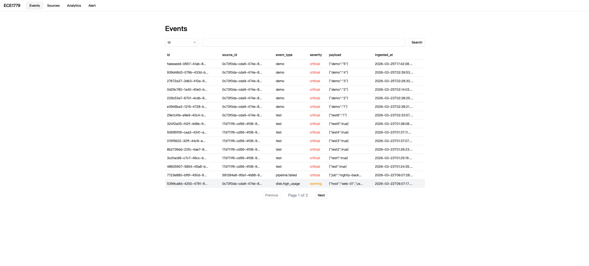
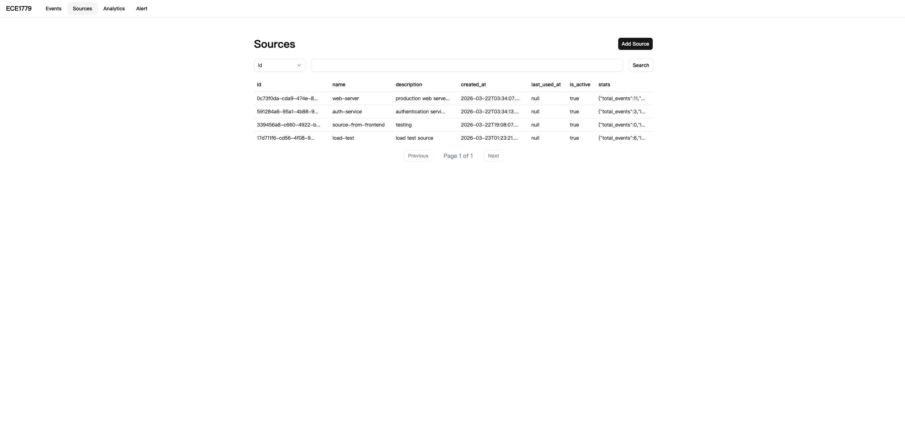
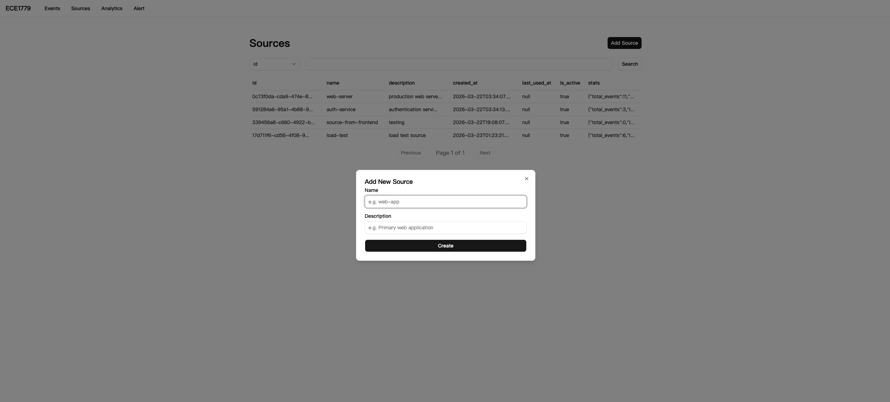
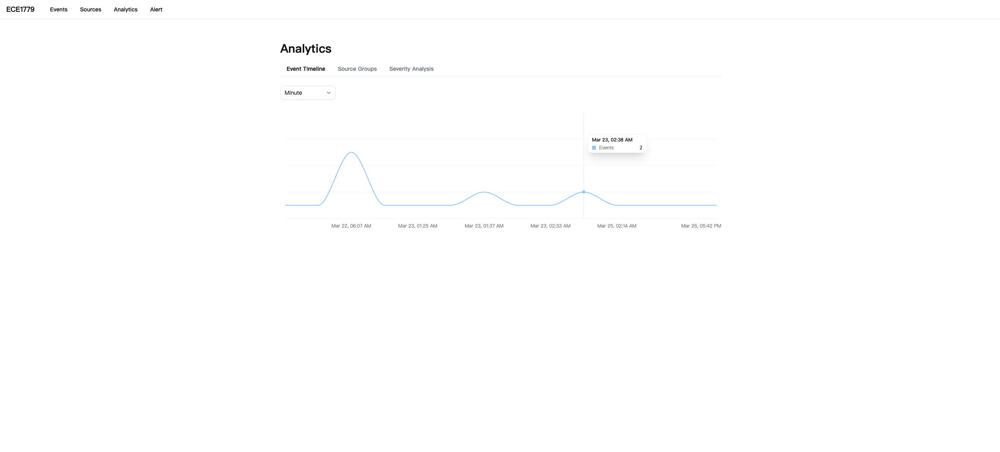
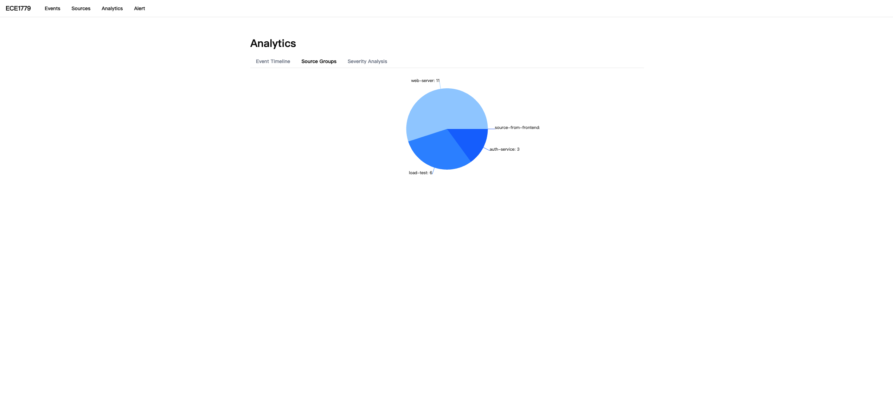
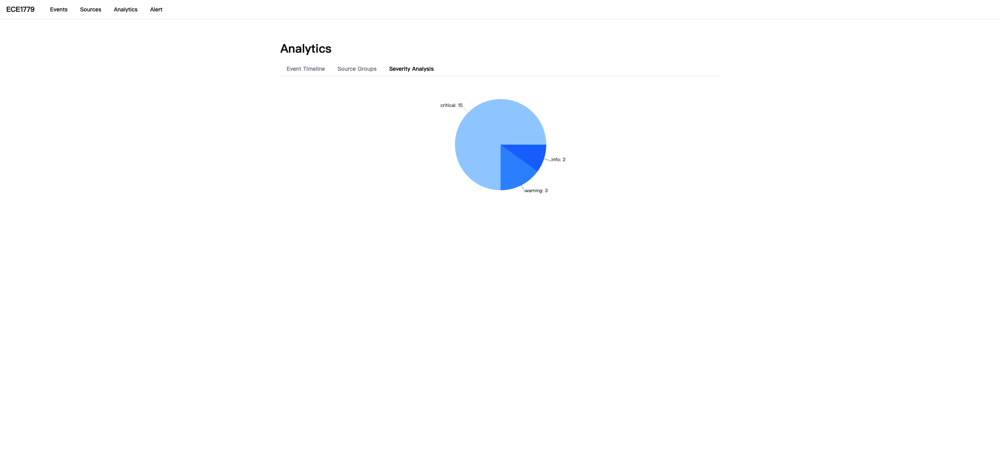
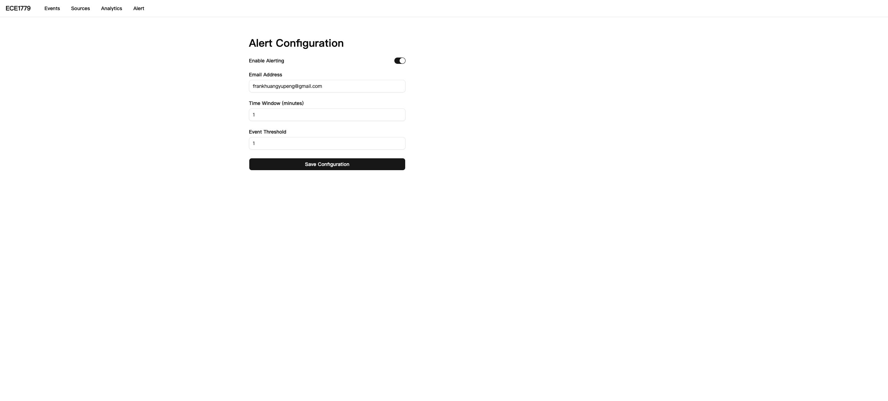

# ECE1779 - Event Logging and Analytics System

## Team Information

| Name         | Student Number | Email                         |
| ------------ | -------------- | ----------------------------- |
| Yupeng Huang | 1003423057     | yupeng.huang@mail.utoronto.ca |
| Ping-Ju Kan  | 1003380432     | brendan.kan@mail.utoronto.ca  |
| Linhao Liu   | 1003242573     | linhao.liu@mail.utoronto.ca   |

---

## Motivation

In the era of the Internet of Things (IoT) and microservices, systems generate a massive amount of event data — temperature sensor readings, CPU usage percentages, login activity, and more. Modern companies and organizations struggle with collecting raw data from numerous sources, normalizing it into a common format, and visualizing it with real-time insights.

This project builds a high-performance, stateful cloud-native platform that provides an end-to-end pipeline for event ingestion, storage, and visualization. Our target users are IoT developers, system administrators monitoring infrastructure health, and product managers tracking real-time system status.

---

## Objectives

- Build a resilient event ingestion API that external sources can push data to
- Persist event data across restarts and redeployments using durable cloud storage
- Visualize ingested data through tables, timelines, and charts for clear system insights
- Deploy a scalable, cloud-native backend on Kubernetes with auto-scaling and high availability
- Implement alerting so users are notified when event thresholds are exceeded

---

## Technical Stack

The application is built as a full-stack cloud-native system.

### Backend

The backend is an Express 5 server written in TypeScript, exposing a REST API at `/api/v1`. It uses a dependency injection and repository pattern, making it straightforward to test with mock repositories.

### Frontend

The frontend is a Next.js 14 application using TypeScript, Tailwind CSS, shadcn/ui components, and Recharts for data visualization.

### Database and Persistent Storage

PostgreSQL 16 serves as the primary database, deployed as a Kubernetes StatefulSet with a 10Gi DigitalOcean block storage PVC. This ensures data persists across pod restarts and redeployments, satisfying the course requirement for stateful persistent storage.

### Containerization and Local Development

Docker and Docker Compose are used to spin up PostgreSQL, the backend, and the frontend together, allowing local development before deploying to the cloud.

### Orchestration

The backend is deployed on DigitalOcean Kubernetes (DOKS) in the Toronto (tor1) region with a minimum of two stateless backend pods and one stateful PostgreSQL pod. The backend is exposed publicly via a Kubernetes LoadBalancer Service, which provisions a DigitalOcean load balancer automatically. A Horizontal Pod Autoscaler (HPA) is configured to scale between two and five replicas based on CPU utilization (threshold set to 60% for at least 90 seconds). The frontend is deployed separately on Fly.io.

### CI/CD

Every push to the `main` branch, will trigger the Github Actions CI/CD pipeline which builds the Docker image, pushes it to GHCR, applies Kubernetes manifests, runs database migrations, and restarts the deployment.

### Backup and Recovery

A Kubernetes CronJob runs daily at 03:00 UTC, dumping the PostgreSQL database with `pg_dump`, compressing it with gzip, and uploading it to DigitalOcean Spaces (S3-compatible object storage).

### Email Notifications

SendGrid handles transactional email notifications when alert thresholds are exceeded.

### Monitoring

DigitalOcean's built-in Kubernetes metrics and alerting dashboards monitor cluster health, with alerts configured for CPU, disk, and memory usage exceeding 70%.

---

## Features

### Feature Overview

#### **Event Ingestion**

Each source registers with the system and receives an API key. They can then push events via the single event endpoint `POST /api/v1/events` or the batch event endpoint `POST /api/v1/events/batch` which takes up to 100 events at once. Each event carries a type, severity, and JSON payload. The auth middleware validates the source's API key before accepting the event. This fulfills the project objective of providing a resilient ingestion API that external sources can push data to.

#### **Event Querying and Persistence**

`GET /api/v1/events` supports filtering by source, type, severity, and time range. Events are persisted in PostgreSQL backed by a DigitalOcean block storage PVC, ensuring data survives pod restarts and redeployments. This directly satisfies the core requirement for stateful persistent storage using Kubernetes PersistentVolumeClaims.

#### **Frontend Dashboard**

The frontend is a Next.js 14 application deployed on Fly.io at https://event-analytics-frontend.fly.dev/. It provides a web interface for viewing ingested events in a table, managing sources, and visualizing analytics through line charts and summary statistics. This satisfies the optional frontend requirement and makes the system accessible without needing to interact with the API directly.

#### **Analytics and Visualization**

`GET /api/v1/stats/timeline` returns aggregated event counts grouped by minute, hour, day, or month. The frontend dashboard renders these as line charts using Recharts. Summary statistics are also available via other analytics endpoints such as `GET /api/v1/stats/source` and `GET /api/v1/stats/severity`. This fulfills the project objective of providing clear system insights through visualization.

#### **Alert Configuration and Email Notifications**

Users can configure an alert rule via `PUT /api/v1/alert/config` specifying a time window, event threshold, and notification email. When events exceed the threshold within the time window, SendGrid sends an email notification automatically. This satisfies the advanced feature requirement for integration with an external service (SendGrid).

#### **Source Management and Security**

Sources can be created, listed, and deleted via `GET/POST/DELETE /api/v1/sources`. Source API keys are stored as a hash in the database, along with a prefix used for indexing. The plain-text API key is returned only once upon creation. All event write and delete operations require Bearer token authentication. Sensitive credentials are managed via Kubernetes Secrets. This satisfies the advanced feature requirement for security enhancements.

#### **Auto-scaling and High Availability**

The backend runs with a minimum of 2 replicas managed by a Kubernetes HPA (2–5 replicas, scaling up when 60% CPU threshold is reached for at least 90 seconds, and 5 minutes before scaling back down). This satisfies the advanced feature requirement for auto-scaling and high availability, ensuring the system remains responsive under increased load.

#### **Backup and Recovery**

A Kubernetes CronJob runs daily at 03:00 UTC, dumping the full PostgreSQL database with `pg_dump`, compressing it with gzip, and uploading it to DigitalOcean Spaces. This satisfies the advanced feature requirement for backup and recovery.

#### **Monitoring and Observability**

DigitalOcean's built-in Kubernetes metrics and alerting dashboards monitor cluster health, with alerts configured for CPU, memory, and disk usage exceeding 70%. This satisfies the core requirement for monitoring and observability using provider tools.

### API Endpoints

#### Events

- GET /api/v1/events
- POST /api/v1/events
- POST /api/v1/events/batch
- DELETE /api/v1/events/:id

#### Sources

- GET /api/v1/sources
- POST /api/v1/sources

#### Stats

- GET /api/v1/stats/timeline
- GET /api/v1/stats/source
- GET /api/v1/stats/severity

#### Alerts

- GET /api/v1/alert/config
- PUT /api/v1/alert/config

## User Guide

### **Accessing the Application**

- **Frontend**: https://event-analytics-frontend.fly.dev/
- **Backend API**: http://159.203.49.172 (Note: if IP changes, run `kubectl get svc backend-svc` to get the current IP)

### **Frontend Dashboard**

The frontend is accessible at https://event-analytics-frontend.fly.dev/ and provides a web interface for all main features.

#### **Events Page**

View and search all ingested events, filterable by id, source, type, and severity.



#### **Sources Page**

View all registered sources and their stats.



Click "Add Source" to register a new source.



#### **Analytics Page**

Visualize event timelines grouped by minute, hour, day, or month. In the Event Timeline page, it shows the number of events broken down into different time intervals.



In the Source Groups page, you can see the number of events from all the different sources in a pie graph.



In the Severity Analysis, you can see the number of events groups by its severity.



#### **Alert Configuration Page**

Configure alerting by setting an email address, time window, and event threshold. Toggle "Enable Alerting" to activate.



---

You can access the available APIs to interact with the Event Ingestion System if you prefer. This can be done by either using `curl` from the command line, or using a tool such as Postman. API Documentations below:

### Health

#### Health Check

Event Ingestion System has a health check endpoint available, which returns the health status of the backend and database connection.

```bash
curl http://159.203.49.172/health
```

Sample Response (healthy):

```json
{
  "status": "ok",
  "db": "connected"
}
```

Sample Response (unhealthy):

```json
{
  "status": "error",
  "db": "disconnected"
}
```

---

### Source

Sources can be created in two ways, either through the frontend UI, or using the API endpoint below. You would need to create sources first before you can ingest events into the system.

#### **Creating a Source**

```bash
curl -X POST http://159.203.49.172/api/v1/sources \
  -H "Content-Type: application/json" \
  -d '{"name": "my-sensor", "description": "a temperature sensor"}'
```

Sample Response:

```json
{
  "id": "803534a1-af7c-4cd9-8392-1f77c89bf0f5",
  "name": "my-sensor",
  "description": "a temperature sensor",
  "created_at": "2026-04-03T05:30:39.068Z",
  "last_used_at": null,
  "is_active": true,
  "api_key": "evt_xxxxxxxx_xxxxxxxxxxxxxxxxxxxxxxxxxxxxxxxxxxxxxxxxxxxxxxxx"
}
```

> **Note:** The response includes an `api_key` — **save this**, it is shown only once. The api key is needed for authorization when ingesting events.

#### **Listing Sources**

We can also view the list of sources in the database. It can be done with this endpoint:

```bash
curl http://159.203.49.172/api/v1/sources
```

Sample Response:

```json
[
  {
    "id": "17d711f6-cd56-4f08-9f16-5d6956561175",
    "name": "load-test",
    "description": "load test source",
    "created_at": "2026-03-23T01:23:21.108Z",
    "last_used_at": null,
    "is_active": true,
    "stats": {
      "total_events": 6,
      "last_event_at": "2026-03-23T01:38:08.378Z",
      "critical_count_24h": 0
    }
  },
  {
    "id": "803534a1-af7c-4cd9-8392-1f77c89bf0f5",
    "name": "my-sensor",
    "description": "a temperature sensor",
    "created_at": "2026-04-03T05:30:39.068Z",
    "last_used_at": "2026-04-03T06:06:08.648Z",
    "is_active": true,
    "stats": {
      "total_events": 2,
      "last_event_at": "2026-04-03T05:59:18.734Z",
      "critical_count_24h": 0
    }
  }
]
```

---

### Events

Once you have a valid source created, it can start ingesting events into the system. Ingesting events can only be done from the API. You can only view the events ingested from the frontend dashboard.

#### **Ingesting Single Event**

Using the api_key obtained from creating a source, you can then ingest events into the Event Ingestion System.

> **Note:** Replace the `source_id` with the Id of the source, and the `<api_key>` for this source.

```bash
curl -X POST http://159.203.49.172/api/v1/events \
  -H "Content-Type: application/json" \
  -H "Authorization: Bearer <api_key>" \
  -d '{
    "source_id": "<source_id>",
    "event_type": "temperature",
    "severity": "info",
    "payload": {"value": 72.3}
  }'
```

Sample Response:

```json
{
  "id": "3a836ec6-cae0-4db8-a55f-2ae3242a0021",
  "source_id": "803534a1-af7c-4cd9-8392-1f77c89bf0f5",
  "event_type": "temperature",
  "severity": "info",
  "payload": {
    "value": 72.3
  },
  "ingested_at": "2026-04-03T05:50:23.335Z"
}
```

#### **Ingesting Events in a batch**

The create event endpoint also supports ingesting bulk events, up to 100 events in a single request. The response will show the number of events successfully created.

> **Note:** Replace the `source_id` with the Id of the source, and the `<api_key>` for this source.

```bash
curl -X POST http://159.203.49.172/api/v1/events/batch \
  -H "Content-Type: application/json" \
  -H "Authorization: Bearer <api_key>" \
  -d '{
    "source_id": "<source_id>",
    "events": [
      {"event_type": "temperature", "severity": "info", "payload": {"value": 72.3}},
      {"event_type": "temperature", "severity": "warning", "payload": {"value": 95.1}}
    ]
  }'
```

Sample Response:

```json
{
  "inserted": 2
}
```

#### **Deleting an Event**

You can also delete events with the API Endpoint. This can be done by specifying the id of the event that you want to delete. Returns `204 No Content` on success.

> **Note:** Replace the `event_id` with the ID of the event to delete. The `api_key` must belong to the source that originally created the event.

```bash
curl -X DELETE "http://159.203.49.172/api/v1/events/<event_id>" \
  -H "Authorization: Bearer <api_key>"
```

#### **Querying Events**

You can query events stored in the database with this endpoint, with optional filters to narrow down results.

```bash
curl http://159.203.49.172/api/v1/events
```

The endpoint supports many different filter options, allowing queries for filtering specific events of interest.

Supported query parameters:

| Parameter    | Type   | Description                                        |
| ------------ | ------ | -------------------------------------------------- |
| `severity`   | string | Filter by severity (`info`, `warning`, `critical`) |
| `source_id`  | string | Filter by source UUID                              |
| `event_type` | string | Filter by event type                               |
| `limit`      | number | Number of results per page (default: 15)           |
| `page`       | number | Page number for pagination                         |

Sample input that filters only for events with severity=info and limits to the first 20 records:

```bash
curl "http://159.203.49.172/api/v1/events?severity=info&limit=20"
```

Sample Response:

```json
{
  "events": [
    {
      "id": "3a836ec6-cae0-4db8-a55f-2ae3242a0021",
      "source_id": "803534a1-af7c-4cd9-8392-1f77c89bf0f5",
      "event_type": "temperature",
      "severity": "info",
      "payload": {
        "value": 72.3
      },
      "ingested_at": "2026-04-03T05:50:23.335Z"
    },
    {
      "id": "db2e1cde-7c19-4a98-a23c-adacc7fe900a",
      "source_id": "0c73f0da-cda9-474e-8fe3-d2c5f201acbd",
      "event_type": "page.view",
      "severity": "info",
      "payload": {
        "path": "/dashboard",
        "duration_ms": 230
      },
      "ingested_at": "2026-03-22T06:07:04.785Z"
    },
    {
      "id": "4150e760-5713-43fd-95a1-c5f5b5ff56cb",
      "source_id": "591284a6-95a1-4b88-9f9e-a1574b9e9e7f",
      "event_type": "login",
      "severity": "info",
      "payload": {
        "user": "alice"
      },
      "ingested_at": "2026-03-22T03:34:41.092Z"
    }
  ],
  "page": 1,
  "total": 3
}
```

---

### Alerts

Besides the alert page in the frontend UI, you can also configure alerts through API.

#### **Configuring Alerts**

Setting up new alerts can be done by setting an email address, time window, and event threshold. When the number of events exceeds the threshold within the time window, an email notification is sent via SendGrid.

```bash
curl -X PUT http://159.203.49.172/api/v1/alert/config \
  -H "Content-Type: application/json" \
  -d '{
    "active": true,
    "time_window_minutes": 5,
    "event_threshold": 100,
    "email": "example@example.com"
  }'
```

Sample Response:

```json
{
  "active": true,
  "time_window_minutes": 5,
  "event_threshold": 100
}
```

> **Note:** This will be reflected in the UI as well.

#### **Getting Alert Configuration**

You can get the alert configurations that is currently set from this endpoint.

```bash
curl http://159.203.49.172/api/v1/alert/config
```

Sample Response:

```json
{
  "active": true,
  "time_window_minutes": 5,
  "event_threshold": 100,
  "email": "example@example.com"
}
```

---

### Analytics

Event Ingestion System offers API endpoints that can get the statistics of the events to be used for analytic purposes.

#### **Event Timeline**

Returns aggregated event counts grouped by a specified time interval. You must select one of the group_by value

```bash
curl "http://159.203.49.172/api/v1/stats/timeline?group_by=hour"
```

Supported `group_by` values: `minute`, `hour`, `day`, `month`

Sample Response:

```json
[
  {
    "time": "2026-03-25T02:00",
    "count": 3
  },
  {
    "time": "2026-03-25T17:00",
    "count": 1
  },
  {
    "time": "2026-04-03T05:00",
    "count": 2
  }
]
```

#### **Events by Source**

Returns total event counts grouped by source, sorted by count in descending order.

```bash
curl http://159.203.49.172/api/v1/stats/source
```

Sample Response:

```json
[
  {
    "source": "auth-service",
    "count": 3
  },
  {
    "source": "my-sensor",
    "count": 3
  },
  {
    "source": "source-from-frontend",
    "count": 0
  }
]
```

#### **Events by Severity**

Returns total event counts grouped by severity.

```bash
curl http://159.203.49.172/api/v1/stats/severity
```

Sample Response:

```json
[
  {
    "severity": "critical",
    "count": 3
  },
  {
    "severity": "warning",
    "count": 1
  },
  {
    "severity": "info",
    "count": 2
  }
]
```

---

## Development Guide

### Prerequisites

- Docker and Docker Compose
- Node.js 20+
- `kubectl` (for production deployment only)
- `doctl` (for production deployment only)

### Local Setup

**1. Clone the repository**

```bash
git clone https://github.com/P311/ECE1779.git
cd ECE1779
```

**2. Configure environment variables**

Create `backend/.env`:

```env
DATABASE_URL=postgres://dev:devpass@db:5432/eventdb
```

> **Note:** `SENDGRID_API_KEY` and `EMAIL_USER` are only configured in production via Kubernetes secrets. Email notifications are disabled in local development. Actual credentials have been sent to TA.

Create `frontend/.env.local`:

```env
NEXT_PUBLIC_API_BASE=http://localhost:8000
```

> **Note:** Credentials sent to TA.

**3. Start all services**

```bash
docker-compose up
```

This starts PostgreSQL on port 5432, the backend on port 8000, and the frontend on port 3000. Database migrations and seed data are applied automatically on first run.

> **Note:** If you have previously run the project, run `docker-compose down -v` first to remove stale volumes before running `docker-compose up`.

**4. Verify the backend**

```bash
curl http://localhost:8000/health
```

Expected response: `{"status":"ok","db":"connected"}`

> **Note:** The frontend may not be able to reach the backend in local development because the backend does not configure CORS headers. To use the frontend locally, either add a CORS middleware to the backend or access the production deployment at https://event-analytics-frontend.fly.dev/.

### Production Deployment

**Backend**
See `deploy.sh` for manual deployment instructions. Prerequisites (run once on a fresh cluster):

```bash
# 0. Configure kubectl to connect to the cluster. Kubeconfig file provided in credentials email to TA.
export KUBECONFIG="path/to/k8s-1-35-1-do-0-tor1-1774148828091-kubeconfig.yaml"

# 1. Create Kubernetes secrets
kubectl apply -f k8s/00-postgres-secret.yaml   # fill in real values, credentials sent to TA
kubectl apply -f k8s/00-backend-secret.yaml    # fill in real values, credentials sent to TA

# 2. Create GHCR pull secret (since the package is private and hosted), credentials sent to TA
kubectl create secret docker-registry ghcr-secret \
  --docker-server=ghcr.io \
  --docker-username=saosnsa \
  --docker-password=GITHUB_TOKEN
# Note: GitHub token must have read:packages scope.

# 3. Create Spaces backup secret, credentials sent to TA
kubectl create secret generic spaces-backup-secret \
  --from-literal=ACCESS_KEY=YOUR_SPACES_ACCESS_KEY \
  --from-literal=SECRET_KEY=YOUR_SPACES_SECRET_KEY

# 4. Install metrics server
kubectl apply -f https://github.com/kubernetes-sigs/metrics-server/releases/latest/download/components.yaml
```

After prerequisites are set up, all future deployments are handled automatically by GitHub Actions on push to `main`, or alternatively running the deploy script from the project root will trigger a deployment right away.

```bash
./deploy.sh
```

**Frontend**

The frontend is deployed on Fly.io in the Toronto (`yyz`) region. A Next.js API route (`src/app/api/[...path]/route.ts`) proxies all `/api/*` requests server-side to the backend, avoiding mixed-content (HTTPS→HTTP) browser errors. The backend URL is configured via the `BACKEND_URL` environment variable in `fly.toml`.

Prerequisites:
- Install the [Fly CLI](https://fly.io/docs/flyctl/install/)
- Authenticate with `fly auth login`

To deploy:

```bash
cd frontend
fly deploy
```

This builds the Docker image using the multi-stage `Dockerfile`, pushes it to Fly.io, and starts the application on port 3000 with HTTPS enforced. The deployment configuration is defined in `frontend/fly.toml`.

---

## Deployment Information

- **Frontend**: https://event-analytics-frontend.fly.dev/
- **Backend API**: http://159.203.49.172
- **Health endpoint**: http://159.203.49.172/health
- **Cluster**: DigitalOcean Kubernetes, Toronto (tor1), 2 nodes (`s-1vcpu-2gb`)

## AI Assistance & Verification (Summary):

AI serves as a knowledge base and served as a design partner for API design. We also use it to implement simple CRUD methods that doesn't have complicated logic involved. The AI shows its limitation in not having a holistic understanding of our requirements. A representative case is when it stores a secret (api key) in our database, it stores it in plaintext. What's worse is because of the lack of semantic understanding of the key it actually returns the key in one of the get calls. We mainly verify the correctness of the AI output through 3 ways. Thorugh inspection by reviewing its changes line by line, detailed unit tests which runs after every change it makes to see what broke and what didn't, repeatable manual end to end tests scenarios to prevent regression.

## Individual Contributions

**Yupeng Huang**

- Backend API routes (alerts, stats)
- Backend database layer (PostgreSQL pool, repository pattern, migrations for alerts table)
- Auth and validation middleware
- SendGrid email integration
- Backend interfaces and tests

**Ping-Ju Kan**

- Backend database layer (PostgreSQL pool, repository pattern, migrations for events and sources table)
- Backend API routes (events, sources)
- Kubernetes infrastructure (k8s manifests, StatefulSet, HPA, secrets)
- CI/CD pipeline (GitHub Actions, GHCR authentication)
- Automated database backup (CronJob, DigitalOcean Spaces)
- Health endpoint and probe configuration
- Deployment scripting

**Linhao Liu**

- Frontend development (Next.js, event table, sources page, navbar, analytics page, alert page, charts, shadcn/Tailwind setup)
- Docker and frontend initial setup
- API documentation
- Frontend Fly.io deployment
- Alert route implementation

---

## Lessons Learned and Concluding Remarks

**Kubernetes is powerful but operationally complex.** Managing secrets, configuring probes with appropriate delays, and understanding rolling update behaviour required significant iteration. Small node sizes (`s-1vcpu-2gb`) constrained what we could run alongside our application workloads.

**CI/CD significantly improves developer experience.** Once the GitHub Actions pipeline was set up, deploying became a single `git push`. The main challenge was authentication between a GitHub org repository and a personal GHCR package, which required careful understanding of token scopes.

**Stateful workloads require careful planning.** Using a StatefulSet with a PVC for PostgreSQL ensured data survived pod restarts, but it also meant migrations had to be idempotent and applied carefully. The `|| true` pattern in migration scripts prevented failures on repeated runs.

**AI tools accelerate but don't replace understanding.** AI was useful for scaffolding configuration and suggesting approaches, but several suggestions required correction — particularly around authentication and permissions. Verifying every AI-generated config against actual cluster behaviour was essential.

Overall, this project gave us hands-on experience with the full lifecycle of a cloud-native application — from local Docker Compose development to a production Kubernetes deployment with auto-scaling, monitoring, CI/CD, and automated backups.

## Video Demo
[ECE1779 Project demo](https://drive.google.com/file/d/1vz5G-8G0YAMfA0F6CM0yVtOjT9SRuuWc/view?usp=sharing)
